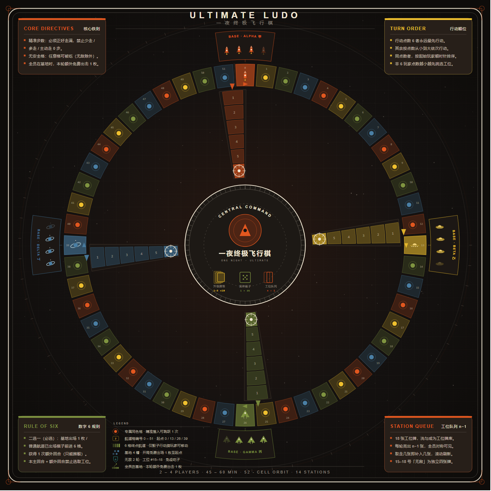
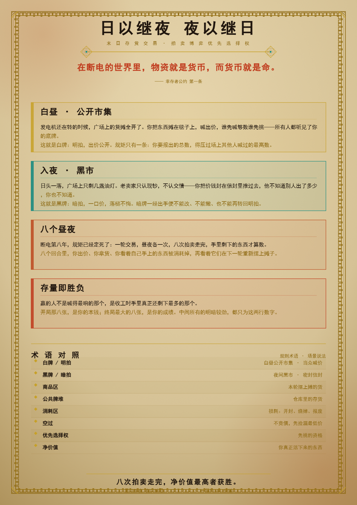

# 自制桌游合集 · Self-Made Boardgames

> 这里收录我用代码 + 算法亲手设计、并实现**网页版**与**打印素材（Print & Play）**的原创桌游。
> 每一款都**现在就能玩**：网页版双击即开，打印版送打印店就能做实体。

[](一夜终极飞行棋/)
[](日以继夜夜以继日/)

## 🎲 现在就能玩的桌游

| 游戏 | 人数 | 时长 | 重度 | 一句话简介 | 入口 |
|---|---|---|---|---|---|
| **一夜终极飞行棋** | 2–4（最佳 3–4） | 15–60 min | 2.3–2.6 | 把童年飞行棋重做成「全员同步暗牌 + 决斗吃子 + 工位博弈」的聚会策略游戏 | [进入](一夜终极飞行棋/) |
| **日以继夜 夜以继日** | 3–8 | 40–80 min | 2.4–2.7 | 出价抢的不是「货」而是「先手」的柴油朋克拍卖棋 | [进入](日以继夜夜以继日/) |

每一款都包含三部分，**全部开箱即玩**：

- **网页版**：纯前端单机游戏，1 名玩家对 1–N 名 AI，双击 `web/index.html` 即玩，零安装。
- **打印版（PnP）**：可直接送打印店的 PDF（棋盘 / 卡牌 / 棋子 / 卡背），含 SVG/PNG 组件原图，可自改自印。
- **完整规则书**：排版版 PDF + 图文互动版 HTML。

## 🧭 关于本仓库

- 所有作品均为**原创桌游设计**，规则书与美术版权归作者所有。
- **个人非商业用途**可自由使用、打印与修改；请勿用于商业售卖。
- 想看设计过程中的机制研判、平衡与评分，见 [设计研判报告](docs/设计研判报告.md)。

## 📂 文件导航

```
Self-made-boadgame/
├── 一夜终极飞行棋/          # 同步暗牌飞行棋（网页版 + PnP + 规则书）
├── 日以继夜夜以继日/        # 柴油朋克拍卖棋（网页版 + PnP + 规则书）
└── docs/
    └── 设计研判报告.md       # 五款原创桌游完整机制研判与评分
```

> 仓库内另附多份独立规则书 PDF（如《三世纪罗马的黄昏》《德州失格》《灯塔争雄》等）作为设计文档留存。
