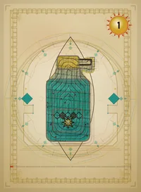
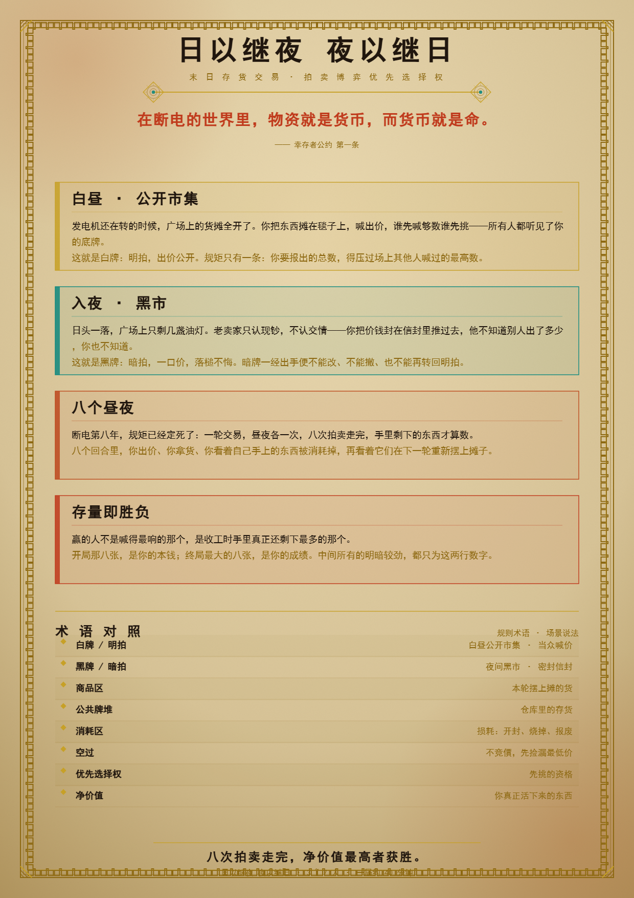

# 日以继夜 夜以继日

> **拍卖 · 博弈 · 优先选择权** —— 一场关于「出价抢先手，而非抢货」的柴油朋克拍卖棋。
> 你争的不是商品，而是**挑选商品的先后次序**。





| 项目 | 参数 |
|---|---|
| 人数 | 3 – 8 人（开启「万能牌模组」可扩展至 8 人） |
| 时长 | 40 – 80 分钟 |
| 类型 | 拍卖变体 / 心理博弈 / 优先选择权 |
| 重度 | 2.4 – 2.7 / 5（轻–中心理拍卖） |
| 机制完成度 | 7.3 / 10 |
| 卡牌 | 112 张（数值 1–56，每值 2 张＝1 白 1 黑） |

---

## 一句话看懂

传统拍卖是「出价高者得货」。**本作反过来**：你出的牌决定的是**下一手挑货的优先权**——
明拍压过全场、暗拍藏一手、明转暗反转局势。谁能在八轮拍卖里把「起始 8 张」滚成「终局最大 8 张」，
谁就赢。净价值（Net Value）最高者获胜。

> **净价值 ＝ 终局手牌中最大 8 张总和 － 起始 8 张总和**

---

## 核心机制

四种回合行动，四选一：

| 行动 | 说明 | 硬约束 |
|---|---|---|
| **明拍**（白牌·面朝上） | 任意张数，整组替换 | 新组总和须压过**全场最大明牌** |
| **暗拍**（黑牌·面朝下） | 仅面前无牌时可出 | 不可改、不可撤、不可转明 |
| **明转暗**（白→黑） | 把明牌翻成暗牌 | 新暗牌须**大于**自己的旧明牌，之后不可再替换 |
| **空过** | 不出牌 | 立即拿全场最低商品，本回合不能再出价 |

结算要点：

- **取货**：明拍明、暗拍暗；暗最大取黑最大、暗第二取黑第二，明最大取白最大、明第二取白第二。
- **兜底**：场上场下剩下的牌颜色完全不同时，不分颜色，按数字从大到小取剩余最大的。
- **消耗**：全场最高明牌与所有暗牌本轮消耗（轮末作为商品回到牌堆），其余明牌收回手牌。
- **起始玩家**：第一场由初始点数最低者先手；此后每场由**上一场获益最少者**先手。

美术采用 70 年代装饰艺术（Art Deco）/ 柴油朋克极简几何语言：昼牌亮底暖金、夜牌深底冷青，
承重线稿与黄铜缝线贯穿全系。

---

## 怎么玩

### 网页版（推荐，零安装）

纯前端单机游戏，**1 名玩家对 7 名 AI**，双击即玩：

```
日以继夜夜以继日/
└── web/
    └── index.html      ← 双击它，浏览器直接开打（file:// 已验证通过）
```

- 开局面板可选 **人数（3–8）**、**AI 难度（休闲 / 标准 / 硬核）**、**万能牌模组（开/关）**。
- 也可部署到任意静态服务器或 GitHub Pages：`web/` 目录整体上传即可。

### 打印版（Print & Play）

`pnp/` 目录提供可直接送打印店的 PDF（A4）：

| 文件 | 内容 |
|---|---|
| `pnp_cards_print.pdf` | 112 张卡牌 3×3/页，含裁切线 + 卡背页（双面打印用） |
| `pnp_modules_print.pdf` | 变体模组组件（代币 / 牌套 / 队伍身份等） |
| `pnp_parts_print.pdf` | 初始资金记录纸 + 净价值计分表 + 新手速查卡 + 区域标记 |
| `pnp_setting.pdf` | 一页设定 |
| `components/` | 上述各组件的 PNG / SVG 原图，可自改自印 |

最终规则书见 [`rulebook/日以继夜夜以继日_规则书_修正版.pdf`](rulebook/日以继夜夜以继日_规则书_修正版.pdf)。

---

## 变体模组（可选）

- **万能牌模组**：开启后每人起手整手 8 张均为万能牌（不分黑白、数值 1~4n 每值恰好 2 张），
  可同时走明暗两线。网页版开局面板一键开启。
- **软时钟 / 最大轮次上限**：可选强制计分结束，避免对局无限拉长（规则书建议的可选开关）。
- **更多模组组件**见 `pnp_modules_print.pdf`（传承 / 极昼极夜 / 光暗双生 / 混沌 / 黑洞）。

---

## 文件结构

```
日以继夜夜以继日/
├── README.md                  # 本文件
├── rulebook/                  # 最终规则书（修正版 PDF）
├── web/                       # 可游玩网页版（1 vs 7 AI，纯前端）
│   ├── index.html
│   ├── css/  js/             # 样式与引擎 / AI / UI
│   └── assets/cards/          # 112 昼夜卡 + 32 万能卡 + 卡背（webp）
└── pnp/                       # 打印素材
    ├── pnp_cards_print.pdf
    ├── pnp_modules_print.pdf
    ├── pnp_parts_print.pdf
    ├── pnp_setting.pdf
    └── components/            # 组件原图（PNG/SVG）
```

---

## 许可

个人非商业用途 freely 使用、打印与修改；请勿用于商业售卖。
本作为原创桌游设计，规则书与美术版权归作者所有。
